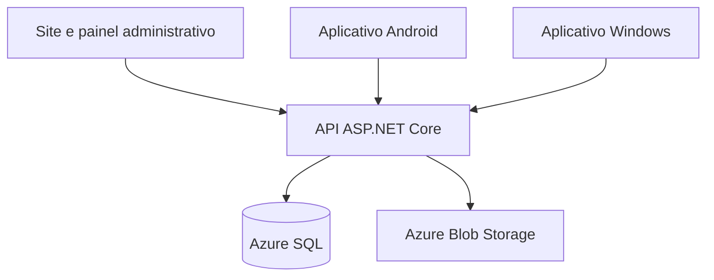

# Coração Animal — solução integrada PIM IV

Plataforma de adoção responsável composta por **site**, **API REST**, **aplicativo Android**, **aplicativo Windows**, **banco de dados** e infraestrutura preparada para o **Microsoft Azure**. As três interfaces utilizam a mesma API e o mesmo banco de dados, portanto cadastros e alterações ficam disponíveis em todos os dispositivos.

> O painel administrativo existe somente no site. Os aplicativos Android e Windows são destinados ao público usuário.

## Acessos online

| Serviço | Link |
|---|---|
| Site | [Abrir Coração Animal](https://coracaoanimal-api-fqegfpe7avcda5cy.chilecentral-01.azurewebsites.net/) |
| API base | [Abrir API](https://coracaoanimal-api-fqegfpe7avcda5cy.chilecentral-01.azurewebsites.net/) |
| Swagger | [Documentação interativa](https://coracaoanimal-api-fqegfpe7avcda5cy.chilecentral-01.azurewebsites.net/swagger/index.html) |
| Downloads | [Versões publicadas](https://github.com/Manoel11-byte/coracao-animal/releases) |

## Baixar os aplicativos

- [Android — APK](https://github.com/Manoel11-byte/coracao-animal/releases/latest/download/CoracaoAnimal-Android.apk)
- [Windows — pacote ZIP](https://github.com/Manoel11-byte/coracao-animal/releases/latest/download/CoracaoAnimal-Windows-x64.zip)
- [Código-fonte completo](https://github.com/Manoel11-byte/coracao-animal/releases/latest/download/CoracaoAnimal-Projeto-Completo.zip)

Os aplicativos se conectam automaticamente à API hospedada no Azure. Não existe tela de configuração de servidor na versão de produção.

## Funcionalidades

- Catálogo de animais com busca e filtros.
- Cadastro, autenticação e manutenção da conta.
- Preferências e recomendações de animais.
- Solicitações e acompanhamento de adoção.
- Registro de intenção de doação.
- Inscrição para voluntariado.
- Sincronização entre site, Android e Windows por API REST.
- Painel administrativo exclusivo no site.
- Upload e armazenamento de fotografias.
- Banco local SQLite para desenvolvimento e Azure SQL/SQL Server em produção.
- Sessões, autorização, validação, proteção CSRF e regras de negócio compartilhadas.

## Arquitetura



| Caminho | Conteúdo |
|---|---|
| `src/CoracaoAnimal.Core` | Entidades, contratos e regras de negócio |
| `src/CoracaoAnimal.Api` | API, site, autenticação e persistência |
| `src/CoracaoAnimal.Client` | Cliente HTTP compartilhado pelos aplicativos |
| `src/CoracaoAnimal.App` | Aplicativo Android em .NET MAUI |
| `src/CoracaoAnimal.Windows` | Aplicativo Windows em WinForms |
| `database` | Modelo físico, índices, procedures, trigger e carga demonstrativa |
| `infra` | Infraestrutura Azure declarada em Bicep |
| `scripts` | Execução, compilação e implantação |
| `tests` | Testes automatizados |
| `docs` | Arquitetura, API, banco, Azure e material do PIM IV |

## Executar localmente

### Requisitos

- SDK .NET 10.
- PowerShell 7 ou Windows PowerShell.
- Para Android: JDK 21, Android SDK 36 e workload `maui-android`.

### Site e API

No Windows, execute `INICIAR-SERVIDOR.cmd`. Alternativamente:

```powershell
powershell -NoProfile -ExecutionPolicy Bypass -File .\scripts\run-local.ps1
```

Informe o e-mail e uma senha com pelo menos 10 caracteres para criar o administrador local. Depois acesse `http://localhost:5080`.

Em desenvolvimento é criado um banco SQLite local. Nenhuma senha real está armazenada no repositório.

### Testes

```powershell
dotnet test .\tests\CoracaoAnimal.Tests -c Release
```

### Aplicativo Windows

```powershell
.\scripts\build-windows.ps1
```

O pacote é gerado para Windows x64 e inclui o runtime necessário.

### Aplicativo Android

```powershell
dotnet workload install maui-android
.\scripts\build-android.ps1
```

O build de demonstração gera um APK Debug. Para distribuição oficial, use uma chave de assinatura própria e nunca publique a senha da chave.

## Configuração da API

Produção utiliza variáveis de ambiente ou configurações do Azure App Service:

| Configuração | Finalidade |
|---|---|
| `Database__Provider` | `SqlServer` em produção ou `Sqlite` localmente |
| `ConnectionStrings__CoracaoAnimal` | Conexão do banco de dados |
| `Storage__ConnectionString` | Conexão do Blob Storage |
| `Storage__Container` | Contêiner de fotografias |
| `Bootstrap__Email` | E-mail inicial do administrador |
| `Bootstrap__Password` | Senha inicial do administrador |

Credenciais não devem ser gravadas em arquivos versionados.

## Implantação no Azure

Leia [`docs/AZURE.md`](docs/AZURE.md). Com a Azure CLI autenticada:

```powershell
.\scripts\deploy-azure.ps1 `
  -ResourceGroup rg-coracaoanimal `
  -Location chilecentral `
  -Prefix coracao `
  -AdminEmail seu-email@exemplo.com
```

A infraestrutura prevê App Service, Azure SQL, Storage, monitoramento, segurança e automação CI/CD. Confira preços, cotas e região antes de executar qualquer provisionamento.

## Documentação

- [`docs/ARQUITETURA.md`](docs/ARQUITETURA.md) — módulos, fluxo e decisões técnicas.
- [`docs/API.md`](docs/API.md) — rotas e contratos REST.
- [`docs/BANCO.md`](docs/BANCO.md) — MER, tabelas, procedures e trigger.
- [`docs/AZURE.md`](docs/AZURE.md) — implantação, operação e CI/CD.
- [`docs/PIM-IV.md`](docs/PIM-IV.md) — rastreabilidade acadêmica e planejamento ágil.
- [`docs/VALIDACAO.md`](docs/VALIDACAO.md) — evidências de compilação e testes.

## Segurança e privacidade

- Não publique senhas, chaves, tokens ou strings de conexão.
- Utilize somente dados fictícios durante demonstrações acadêmicas.
- Troque a senha inicial do administrador após o primeiro acesso.
- Use HTTPS em produção e restrinja permissões dos serviços Azure.
- APKs externos ao Google Play podem exigir autorização manual do Android para instalação.

## Observações

O sistema registra intenções de doação; não processa pagamentos. As recomendações utilizam afinidade matemática com preferências declaradas e não garantem aprovação da adoção. Cada solicitação deve ser avaliada pela equipe responsável.

Projeto acadêmico desenvolvido para o PIM IV do curso de Análise e Desenvolvimento de Sistemas.
