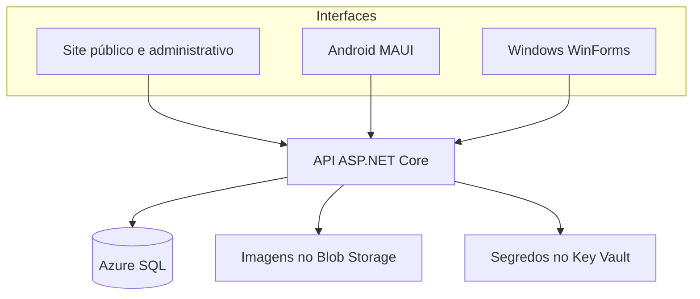
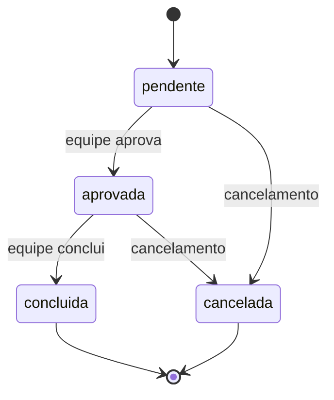

# Arquitetura e decisões

## Contexto

Coração Animal é a organização fictícia de acolhimento e adoção de animais do projeto fornecido. O sistema centraliza catálogo, candidatos à adoção, solicitações, contribuições e voluntariado. A proposta de valor é reduzir registros dispersos, dar visibilidade do andamento ao adotante e permitir que a equipe organize os processos pelo site. O domínio e as interfaces devem ser validados pelo grupo e pelo orientador com o PIM III definitivo.

## Componentes

O site é servido pelo mesmo host da API. Evita CORS desnecessário e mantém autenticação por cookie restrita à origem. Os aplicativos usam HTTPS e tokens opacos; não contêm credenciais SQL. Um usuário pode consultar os mesmos registros em qualquer cliente.

## Camadas

- **Core:** entidades e contratos independentes de banco, validações, transições e cálculo de afinidade.
- **Application:** casos de uso de conta e adoção; validações e transações.
- **Infrastructure:** EF Core, SQL Server/SQLite, sessão e armazenamento de fotos.
- **API:** contratos HTTP e políticas de acesso. O site utiliza esses mesmos contratos.
- **Client:** transporte HTTP e armazenamento de sessão abstrato.
- **Interfaces nativas:** MAUI no Android e WinForms no Windows, com armazenamento protegido específico da plataforma.

WinForms foi adotado no Windows para gerar um executável autossuficiente e manter uma interface desktop nativa. Contratos e transporte são compartilhados com o Android. As interfaces têm código próprio para cada plataforma.

## Autenticação e autorização

Senhas são verificadas pelo PasswordHasher do ASP.NET Core, com PBKDF2 e 210 mil iterações. A API gera tokens aleatórios de 256 bits; apenas seu hash SHA-256 fica no banco. Sessões web expiram em 8 horas; sessões de app em 7 dias. Logout e alteração de senha invalidam sessões no servidor. Não há recuperação de senha por e-mail nesta versão.

O navegador recebe cookie HttpOnly e SameSite Strict, marcado Secure sob HTTPS. Os apps recebem um token Bearer. Android usa SecureStorage; Windows usa DPAPI para o usuário do sistema. Alterar o servidor limpa a sessão anterior. O cliente rejeita HTTP fora de localhost e do endereço especial do emulador.

A política AdminWeb exige papel administrativo e sessão criada para o cliente web. Os apps não oferecem telas administrativas; suas sessões não acessam as rotas de administração. Essa distinção organiza os canais de acesso, mas não é atestação do dispositivo: um cliente HTTP pode implementar o protocolo web, sempre sujeito à credencial administrativa.

Há limitação de tentativas por IP nas rotas de autenticação, bloqueio de conta após 5 erros, verificações de origem e cabeçalho nas operações de escrita web e políticas CSP/anti-framing. Os registros privados são filtrados pelo usuário autenticado. O cadastro não aceita o papel do usuário como parâmetro.

## Consistência

Solicitar adoção exige perfil completo, aceite do compromisso e animal disponível. A transação serializável cria a solicitação e reserva o animal. Um índice filtrado único permite somente uma adoção ativa por animal. Aprovação não conclui automaticamente a adoção. Cancelamento libera o animal; conclusão marca como adotado.

Doações são intenções pendentes. Somente a administração confirma recebimento; valores confirmados não podem ser cancelados pelo adotante. O anonimato significa não divulgar publicamente o nome, sem impedir a identificação pela equipe. O cadastro de voluntariado é único por usuário e pode ser desativado e retomado.

## Fotos e dados

Fotos passam por limite de tamanho e verificação de assinatura de JPG/PNG/WEBP, recebem nome aleatório e ficam fora da pasta pública do site. O Blob não permite leitura anônima; a API fornece a imagem pública do catálogo. A verificação de assinatura não substitui decodificação completa ou antivírus. Para operação real, considerar reprocessamento das imagens e rotina de remoção de arquivos órfãos.

Dados pessoais não são gravados em localStorage. O site armazena somente o tema. Os apps não mantêm cópia offline de cadastros e históricos. Logs de aplicação devem evitar corpo de requisições, senhas e tokens. A política de retenção, contato responsável e atendimento aos titulares precisa ser definida pela organização real antes da operação com dados reais.

## Escala e limites

API e sessões são compartilhadas por banco; fotos ficam no Blob. Isso permite múltiplas instâncias sem depender de disco local. O plano inicial B1 tem uma instância; não há autoscaling configurado. Adoções podem disputar o mesmo registro; conflitos exigem atualização pelo cliente, sem reenvio automático de operações financeiras ou adoções.

O catálogo e as telas administrativas são paginados. Históricos individuais não são paginados nesta versão. Recomendações carregam os animais disponíveis e calculam similaridade de cosseno sobre espécie, porte e idade aproximada conforme experiência. Para bases grandes, é necessário limitar candidatos e revisar as consultas antes de aumentar a escala.

## Inclusão e acessibilidade

O site tem rótulos de formulário, navegação por teclado, foco visível, tema claro/escuro e adaptação a telas menores. Os apps usam controles nativos e campos identificados. A avaliação de adoção deve considerar condições concretas de cuidado; raça, origem ou identidade do candidato não integram o algoritmo. Validação manual com TalkBack, leitor de tela do Windows e pessoas usuárias permanece necessária; não se afirma certificação de acessibilidade.
