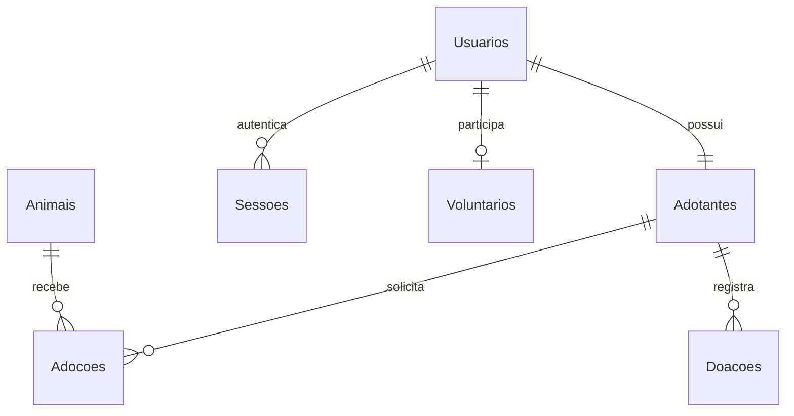

# Banco de dados

O modelo físico SQL Server/Azure SQL completo está em `database/schema.sql`. O script é destinado a um banco novo; não converte nem apaga os dados do PIM III. `SchemaVersions` registra a versão inicial. Alterações futuras de esquema exigem scripts incrementais versionados; executar novamente a versão 1 não altera colunas existentes.

## Modelo lógico / MER



## Dicionário resumido

| Tabela | Chave e campos | Regras |
|---|---|---|
| Usuarios | Id, Nome, Email, SenhaHash, Papel, Cpf, Telefone, Endereco, Tentativas, BloqueadoAte, CriadoEm | E-mail único normalizado, CPF único quando preenchido; papel usuario/admin |
| Sessoes | Hash, UsuarioId, Cliente, ExpiraEm | Hash do token como PK, FK para usuário, cliente web/app |
| Adotantes | Id, UsuarioId, EspeciePreferida, Espaco, Experiencia | Uma linha por usuário |
| Animais | Id, Nome, Especie, Raca, Idade, Porte, Status, Descricao, FotoUrl, Arquivado, CriadoEm | Idade 0–40; estados controlados; arquivamento preserva histórico |
| Adocoes | Id, AnimalId, AdotanteId, Status, Ativa, Observacoes, CriadoEm, AtualizadoEm | FKs e somente uma ativa por animal |
| Doacoes | Id, AdotanteId, Valor decimal(10,2), FormaPagamento, Status, Descricao, Anonima, CriadoEm | Valor 1–1.000.000, máximo duas casas; confirmação administrativa |
| Voluntarios | Id, UsuarioId, Area, Disponibilidade, Status, CriadoEm | Uma inscrição por usuário |
| Auditorias | Id bigint, UsuarioId opcional, Acao, Entidade, RegistroId, CriadoEm | Registro de eventos; referência polimórfica à entidade, sem FK para o registro |
| SchemaVersions | Versao, AplicadaEm | Controle da versão SQL aplicada |

Campos de texto usam nvarchar; identificadores são inteiros, flags usam bit e datas usam datetime2 em UTC. Tamanhos, defaults, checks e FKs estão no script físico. Não se armazenam senhas ou tokens em texto puro. O banco mantém dados pessoais necessários ao fluxo, protegidos pelo controle de acesso da aplicação.

## Índices e desempenho

- E-mail e CPF únicos previnem duplicidade de contas e perfis.
- `IX_Adocoes_AnimalAtivo` é único e filtrado por Ativa=1.
- Índice de catálogo cobre Arquivado/Status/Especie/Porte e inclui Nome/Idade.
- Adoções e doações têm índices por AdotanteId/CriadoEm.
- Sessões têm índices por ExpiraEm e UsuarioId.
- Consultas de leitura usam AsNoTracking e paginação onde aplicável.

A existência de índices não demonstra ganho mensurado. Antes de operação em escala, comparar planos de execução e leituras lógicas com volume representativo. Busca textual por trecho pode precisar de busca full-text em bases grandes.

## Programação SQL

`trg_Adocoes_Auditoria` registra inserções e alterações de estado em Auditorias. É set-based e considera todas as linhas de inserted/deleted. A API também registra o usuário que alterou uma adoção ou confirmou/cancelou uma doação. Pode haver dois eventos complementares para uma transição: evento técnico do banco e evento com autor na aplicação.

`usp_ResumoMensal @Ano` agrega quantidade e valor de doações confirmadas por mês de criação. Meses sem registros não aparecem. Não representa fluxo de caixa por data de recebimento, pois não existe campo DataConfirmacao nesta versão.

```sql
EXEC dbo.usp_ResumoMensal @Ano = 2026;
EXEC dbo.usp_LimparSessoesExpiradas;
```

`usp_LimparSessoesExpiradas` remove sessões vencidas. Pode ser agendada externamente; não há job SQL Agent no Azure SQL Database. O login também limpa sessões expiradas. As procedures estão entregues para execução operacional/acadêmica, não são chamadas pelo painel atual.

## Providers e validação

Development e testes utilizam SQLite criado a partir do modelo EF Core. A produção utiliza o script SQL Server, incluindo trigger e procedures que não existem no SQLite. Testes SQLite não certificam o comportamento específico do Azure SQL, seus bloqueios ou as procedures. O teste de implantação com SQL Server/Azure SQL é um passo obrigatório antes de usar dados reais.

## Credenciais e inicialização

O Bicep cria a infraestrutura e armazena conexões no Key Vault. No primeiro início a API utiliza uma conexão de provisionamento para aplicar o esquema e criar o usuário contido `ca_runtime`. A conexão normal usa esse usuário, membro de db_datareader/db_datawriter, com EXECUTE nas duas procedures. Essas permissões cobrem todo o esquema da aplicação; uma política ainda mais restrita por tabela pode ser adotada posteriormente.

Depois de validar a inicialização, `finalize-azure.ps1` remove as configurações temporárias de bootstrap e provisionamento. O administrador inicial só é criado se não existir administrador; uma conta existente não é promovida automaticamente. A rotação da senha runtime exige atualizar o usuário SQL e o segredo correspondente, seguida da atualização das referências do App Service.

## Backup e recuperação

O template configura retenção SQL de 7 dias e retenção de exclusão de blobs de 7 dias. Validar restauração em outro banco e consistência entre banco/fotos. Backup não substitui teste de restauração. Não houve restauração executada nesta entrega.
