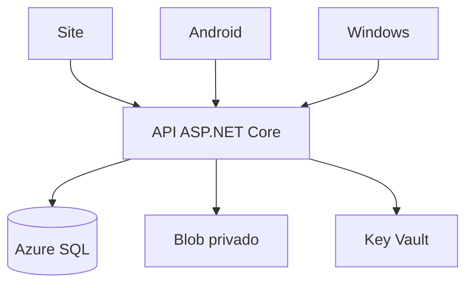

# Coração Animal - Documentação técnica

Revisão de 05/11/2026, horário de Brasília. Projeto acadêmico PIM IV / UNIP.

## 1. Objetivo e escopo

O sistema reúne catálogo de animais, contas de adotantes, solicitações de adoção, intenções de doação e voluntariado. O site atende o público e a equipe administrativa. Android e Windows atendem o adotante. As três interfaces acessam a mesma API; não conectam diretamente ao banco.

Repositório: https://github.com/Manoel11-byte/coracao-animal

Ambiente público: https://coracao-pkzqbhzfiqlry.azurewebsites.net/

Versões de distribuição revisadas: Android 1.0.4 (código 5) e Windows 1.0.5. A versão dos pacotes nativos é independente da versão padrão 1.0.2 do código compartilhado. A revisão de testes desta documentação acrescenta cenários de homologação, sem converter os pacotes de teste em versões de distribuição.

O projeto não realiza cobrança, geração de Pix ou transferência financeira. Uma doação cadastrada é apenas uma intenção. Não há recuperação de senha por e-mail, notificações push ou sincronização automática em tempo real.

## 2. Arquitetura

### 2.1 Componentes

| Componente | Responsabilidade | Implementação |
| --- | --- | --- |
| Site | Catálogo, área do adotante e administração | HTML, CSS e JavaScript servidos pelo ASP.NET Core |
| Android | Catálogo e operações do adotante | .NET MAUI, net10.0-android, Android 7 / API 24 ou superior |
| Windows | Catálogo e operações do adotante | WinForms, net10.0-windows, pacote autossuficiente x64 |
| Client | Transporte JSON/HTTP e sessões nativas | CoracaoAnimal.Client |
| Core | Entidades, contratos, validações e afinidade | CoracaoAnimal.Core |
| API | Autorização, casos de uso e persistência | ASP.NET Core 10, Minimal APIs e EF Core |
| Dados | Registros compartilhados e sessões | Azure SQL em produção; SQLite restrito a desenvolvimento/teste |
| Fotos | Arquivos enviados pela administração | Azure Blob privado, servido por rota da API |
| Segredos | Referências de configuração do aplicativo | Azure Key Vault e identidade gerenciada |

O site compartilha a origem da API. Os aplicativos chamam o endereço HTTPS central. Alterações ficam disponíveis após nova consulta: abrir novamente a seção ou atualizar o catálogo. Não há canal WebSocket ou SignalR para atualizar telas já abertas. Iniciar um servidor local não muda o endereço dos aplicativos distribuídos: eles continuam apontando para o Azure. A homologação local usa compilações específicas de teste, descritas na seção 8.

### 2.2 Organização do repositório

| Caminho | Conteúdo |
| --- | --- |
| src/CoracaoAnimal.Core | Entidades, contratos, regras de entrada, afinidade e valores monetários |
| src/CoracaoAnimal.Client | ApiClient, validação de endereço e interface de armazenamento de sessão |
| src/CoracaoAnimal.Api/Application | Casos de uso de contas e adoções |
| src/CoracaoAnimal.Api/Infrastructure | EF Core, autenticação, fotos e inicialização do banco |
| src/CoracaoAnimal.Api/wwwroot | Site público, portal e arquivos estáticos |
| src/CoracaoAnimal.App | Interface e armazenamento seguro Android |
| src/CoracaoAnimal.Windows | Interface WinForms, DPAPI e leitor de fotos |
| frontend | Fontes da página pública original |
| database/schema.sql | DDL SQL Server, índices, trigger e procedimentos |
| infra/main.bicep | Modelo de instalação Azure nova |
| scripts | Compilação, publicação, importação do site e provisionamento |
| tests | Testes de API, cliente, navegador e interfaces nativas |
| .github/workflows | Validação, empacotamento e publicação Azure |

### 2.3 Dependências principais

A API usa EF Core SQL Server/SQLite 10.0.5, Azure.Storage.Blobs 12.25.1 e System.Security.Cryptography.Pkcs 10.0.13. O Android usa Microsoft.Maui.Controls 10.0.0. O Windows fixa runtime 10.0.14, usa DPAPI e SkiaSharp 4.154.0. O CI instala SDK .NET 10.0.x, Java 21 e Android SDK 36 para compilação. O teste de emulador usa Android API 35. Playwright 1.58.2 executa a revisão web.

As versões exatas estão nos arquivos csproj e workflows. A auditoria NuGet deve ser executada novamente ao alterar dependências; um relatório sem vulnerabilidades conhecidas não garante ausência de falhas desconhecidas.

## 3. Perfis e funcionalidades

| Área | Público | Usuário autenticado | Administrador web |
| --- | --- | --- | --- |
| Catálogo e detalhes | Consulta | Consulta e recomendações | Consulta e manutenção |
| Conta | Cadastro e login | Perfil, senha e logout | Mesma conta, com papel administrativo |
| Adoção | Informações do animal | Solicitar, acompanhar e cancelar pedidos permitidos | Aprovar, concluir ou cancelar |
| Doação | Informação | Registrar e cancelar intenção pendente | Confirmar recebimento ou cancelar pendência |
| Voluntariado | Informação | Inscrever, atualizar e desativar | Ativar, desativar e consultar |
| Dados administrativos | Sem acesso | Sem acesso | Resumo, animais, adotantes, adoções, doações e voluntários |

As interfaces nativas possuem quatro áreas: Explorar, Adoções, Ajudar e Conta. Administração é exclusiva do site e da política AdminWeb. Contas administrativas não obtêm acesso administrativo usando sessão do tipo app.

### 3.1 Processo de adoção

É necessário perfil completo, CPF válido, telefone, endereço e aceite do compromisso. O animal precisa estar disponível. A transação serializável cria a solicitação e reserva o animal. O índice único de adoção ativa protege contra pedidos simultâneos para o mesmo animal.

Fluxo: pendente -> aprovada -> concluída. Pendente ou aprovada também podem ser canceladas. Cancelamento libera o animal. Conclusão marca o animal como adotado. Arquivamento preserva registros históricos e exige ausência de adoção ativa.

### 3.2 Doações e voluntariado

Doações aceitam valor positivo a partir de R$ 1,00, até duas casas decimais e forma pix, transferência ou dinheiro. Somente pendências podem ser canceladas pelo usuário. Confirmar recebimento é uma ação administrativa; a aplicação não executa o pagamento. A opção de anonimato não oculta o registro da equipe.

O voluntariado é único por usuário. Uma inscrição desativada pode ser retomada e volta a pendente. A equipe define a situação ativa ou inativa. Atualizar área ou disponibilidade não cria uma segunda inscrição.

### 3.3 Recomendações

A API calcula similaridade de cosseno com características de espécie, porte e idade aproximada associada à experiência. Retorna até 12 animais disponíveis, ordenados por afinidade e nome. A pontuação é orientação inicial, não aprovação automática ou garantia de compatibilidade. Para crescimento da base, deve-se revisar o carregamento dos candidatos em memória.

## 4. Modelo de dados

| Tabela | Dados principais | Relacionamento e proteção |
| --- | --- | --- |
| Usuarios | Nome, e-mail, hash de senha, papel, CPF, telefone, endereço, bloqueio e criação | E-mail único; CPF único quando informado; papel limitado a usuario/admin |
| Sessoes | Hash do token, usuário, canal e validade | Chave por hash; usuário obrigatório; canal web/app |
| Adotantes | Usuário, espécie preferida, espaço e experiência | Um perfil por usuário |
| Animais | Nome, espécie, raça, idade, porte, situação, descrição, FotoUrl e arquivamento | Catálogo indexado por arquivamento, situação, espécie e porte |
| Adocoes | Animal, adotante, situação, flag ativa, observações e datas | Uma adoção ativa por animal; referências preservadas |
| Doacoes | Adotante, valor decimal(10,2), forma, situação, descrição, anonimato e data | Histórico por adotante/data; sem cobrança automática |
| Voluntarios | Usuário, área, disponibilidade, situação e criação | Uma inscrição por usuário |
| Auditorias | Usuário, ação, entidade, registro e criação | Histórico de ações do domínio |

FKs usam restrição de exclusão. Animais são arquivados em vez de removidos fisicamente. Datas são armazenadas em UTC e apresentadas no horário local das interfaces.

O DDL SQL Server contém CHECKs para valores enumerados e faixas, índices filtrados, trigger de auditoria de adoções e os procedimentos usp_ResumoMensal e usp_LimparSessoesExpiradas. A criação de procedimentos não equivale a agendamento automático: não há rotina periódica de limpeza de sessões demonstrada no código.

SQLite usa EnsureCreated para testes. Ele não substitui a validação de DDL, trigger, procedimentos e concorrência específica do Azure SQL. schema.sql deve ser aplicado a banco novo compatível; o script detecta um esquema legado do PIM III com estrutura incompatível e interrompe a execução.

Fotos de demonstração ficam em wwwroot/img. Fotos enviadas recebem nome aleatório e sua URL fica no registro do animal. O arquivo binário fica no Blob, não na tabela Animais.

## 5. Contrato HTTP

Prefixo da API: /api. Corpos e respostas usam JSON com nomes camelCase, exceto envio de fotos, que usa multipart/form-data. Erros incluem mensagem e traceId. Códigos relevantes: 400 validação; 401 sessão ausente/inválida; 403 autorização/origem; 404 inexistente; 409 conflito de estado; 429 limitação de tentativas; 500 falha interna.

### 5.1 Rotas públicas e autenticação

| Método | Rota | Finalidade |
| --- | --- | --- |
| GET | /health/live | Sinal de processo ativo |
| GET | /health/ready | Conectividade com o banco |
| GET | /api/resumo | Totais públicos e séries mensais de adoções/doações |
| GET | /api/animais | Catálogo paginado com busca, espécie, porte e situação |
| GET | /api/animais/{id} | Detalhe de animal não arquivado |
| GET | /api/fotos/{nome} | Conteúdo de uma foto válida |
| POST | /api/auth/cadastro | Cadastro sem escolha de papel administrativo |
| POST | /api/auth/login | Sessão web por cookie ou app por Bearer |
| POST | /api/auth/logout | Invalida a sessão atual |

Catálogo usa pagina >= 1 e tamanho entre 1 e 50. A consulta retorna itens, total, paginaAtual e tamanho. Busca considera nome e raça. Históricos individuais ainda não possuem paginação.

### 5.2 Área do usuário

| Método | Rota | Finalidade |
| --- | --- | --- |
| GET / PUT | /api/me/ | Consultar ou atualizar perfil |
| PUT | /api/me/senha | Trocar senha e invalidar sessões |
| GET | /api/me/recomendacoes | Recomendações do perfil autenticado |
| GET / POST | /api/me/adocoes | Consultar ou solicitar adoção |
| POST | /api/me/adocoes/{id}/cancelar | Cancelar solicitação permitida |
| GET / POST | /api/me/doacoes | Histórico ou nova intenção |
| POST | /api/me/doacoes/{id}/cancelar | Cancelar intenção pendente |
| GET / PUT / DELETE | /api/me/voluntariado | Consultar, inscrever/atualizar ou desativar |

Os filtros de proprietário usam o usuário autenticado no servidor. Informar identificador de outro usuário no corpo não concede acesso aos registros dele.

### 5.3 Administração web

| Método | Rota | Finalidade |
| --- | --- | --- |
| GET | /api/admin/resumo | Indicadores administrativos |
| POST | /api/admin/animais | Novo animal |
| PUT / DELETE | /api/admin/animais/{id} | Editar ou arquivar |
| POST | /api/admin/animais/{id}/foto | Enviar foto |
| GET | /api/admin/adotantes | Lista paginada, CPF mascarado |
| GET | /api/admin/adocoes | Lista paginada de pedidos |
| PUT | /api/admin/adocoes/{id}/status | Aprovar, concluir ou cancelar |
| GET | /api/admin/doacoes | Lista paginada de intenções |
| PUT | /api/admin/doacoes/{id}/status | Confirmar ou cancelar pendência |
| GET | /api/admin/voluntarios | Lista paginada de inscrições |
| PUT | /api/admin/voluntarios/{id}/status | Pendente, ativo ou inativo |

O catálogo administrativo reutiliza /api/animais. As listas administrativas usam páginas de 50 registros.

## 6. Autenticação e segurança

Senhas usam PasswordHasher do ASP.NET Core, PBKDF2 e 210.000 iterações. Tokens opacos usam 32 bytes aleatórios. O banco guarda SHA-256 do token, não o token em claro. Validade: 8 horas para web e 7 dias para app.

O cookie web é HttpOnly, SameSite Strict e Secure quando a requisição é HTTPS. O token app é Bearer. O servidor impede usar cookie web como Bearer e token app como cookie. O Android usa SecureStorage. O Windows usa DPAPI no escopo do usuário do sistema. Não há cache offline de cadastros e históricos.

A API verifica X-CSRF ou Bearer nas escritas e rejeita Origin diferente da própria origem. AdminWeb exige usuário autenticado, papel admin e canal web. O parâmetro cliente não é atestação do dispositivo: a credencial e a política continuam sendo os controles de acesso.

Há limite de 30 requisições de autenticação por IP por minuto e bloqueio de conta por 15 minutos após cinco falhas. Logout invalida a sessão atual; troca de senha invalida todas as sessões. Requisições autenticadas não são reenviadas automaticamente após timeout, para evitar repetição de adoção ou doação.

Cabeçalhos: CSP restrita à origem para scripts, bloqueio de frames, nosniff e Referrer-Policy same-origin. CSS permite unsafe-inline e fontes Google; essas exceções não equivalem a CSP máxima. O site persiste apenas preferência de tema em localStorage.

Uploads aceitam JPG, PNG ou WebP com assinatura de arquivo e até 5 MB. A verificação do servidor não inclui antivírus ou normalização completa de imagem. O Windows usa SkiaSharp para compatibilidade consistente com WebP, limite de 20 milhões de pixels e até três decodificações simultâneas. Falhas exibem Foto indisponível.

## 7. Azure e publicação

### 7.1 Ambiente existente e modelo de instalação

A última configuração observada do ambiente existente usa App Service Linux F1 com .NET 10, Azure SQL Basic, Blob e Key Vault. A revisão anterior confirmou auditoria SQL ativa com identidade gerenciada, armazenamento existente e retenção de sete dias. O firewall SQL foi limitado aos endereços de saída observados do App Service. Esses dados são uma fotografia da revisão operacional anterior, não uma nova certificação das configurações nesta rodada de testes.

O Bicep é um modelo de instalação nova: cria plano B1, integração de rede virtual, SQL Basic, armazenamento, Key Vault, identidade e logs. Portanto, o template não descreve integralmente o ambiente F1 adaptado. Não reaplicar Bicep no ambiente existente sem plano explícito de migração.

O script deploy-azure.ps1 interrompe o provisionamento quando encontra App Service, SQL ou Key Vault existentes, antes de gerar novas credenciais. Para atualização de código, usar publish-web.ps1 ou workflow Deploy Azure. As referências temporárias de bootstrap e conexão administrativa foram removidas do App Service; Initialize e SeedDemo permanecem desabilitados na configuração observada de produção.

### 7.2 Configurações

| Chave | Uso |
| --- | --- |
| ASPNETCORE_ENVIRONMENT | Production no Azure; Development/Testing em testes locais |
| Database__Provider | SqlServer em produção; Sqlite apenas local/teste |
| ConnectionStrings__CoracaoAnimal | Conexão runtime, preferencialmente via referência ao Key Vault |
| Database__Initialize | Inicialização explícita, desabilitada no ambiente já provisionado |
| Database__SeedDemo | Dados fictícios, desabilitados em produção |
| Storage__ConnectionString | Acesso ao Blob; manter fora do repositório |
| Storage__Container | Contêiner fotos |
| Bootstrap__Email / Bootstrap__Password | Somente bootstrap controlado de instalação nova |

Nunca incluir strings de conexão, senhas, tokens ou certificados privados na documentação, nos artefatos de revisão ou no Git. A identidade do aplicativo deve ter o menor escopo necessário. Remover uma referência de segredo não remove automaticamente permissões ao cofre.

### 7.3 Downloads públicos

A release v1.0.5 do GitHub reúne Windows 1.0.5 e Android 1.0.4. O workflow Publish reviewed downloads recupera os mesmos artefatos imutáveis já revisados e entregues, confere SHA-256 antes da publicação e publica SHA256SUMS.txt. O APK não é recompilado nesse processo, preservando a assinatura do arquivo entregue. O PDF é gerado de docs/DOCUMENTACAO-TECNICA.md por docs/build-technical-pdf.py. O arquivo de fontes corresponde ao commit em SOURCE-COMMIT.txt; os binários preservam as referências históricas revisadas. Para próximas versões, revisar IDs e hashes fixados no workflow antes de publicar outros pacotes.

Windows ZIP: a393ddd20c895d091f39009e943ed0aac1066c1221455aeb61485a342f16f618.

Android APK: 90a1efcab31fca0b96fdd50d27bdc637c30c60fd81e39291581b4560940b733a.

Página pública: https://github.com/Manoel11-byte/coracao-animal/releases/tag/v1.0.5

### 7.4 Compilação e atualização

Para validar a API: dotnet test tests/CoracaoAnimal.Tests -c Release.

Para compilar Windows: pwsh scripts/build-windows.ps1. O pacote inclui runtime e bibliotecas nativas em executável autossuficiente win-x64. Para reproduzir o PDF em Linux/WSL, instalar scripts/requirements-docs.txt, disponibilizar as fontes DejaVu Sans e executar python docs/build-technical-pdf.py. Para publicar site existente: pwsh scripts/publish-web.ps1 -ResourceGroup rg-coracaoanimal -AppName coracao-pkzqbhzfiqlry.

Para Android de desenvolvimento: pwsh scripts/build-android.ps1. Para distribuição atualizável, usar KeyStore e alias da versão anterior e CA_SIGNING_PASSWORD no ambiente. Não gravar o certificado privado no Git. O APK do CI usa assinatura de desenvolvimento; a continuidade de assinatura não é garantida entre runners. O Windows não possui assinatura Authenticode configurada.

Após publicar: conferir /health/ready, catálogo, fotos, login e autorização; comparar versão/artefato com o commit aprovado. Conservar pacote anterior para reversão de código. Reversão de código não desfaz alterações no esquema ou dados: qualquer migração requer plano próprio de backup e compatibilidade.

## 8. Estratégia de testes

### 8.1 Camadas

| Camada | Ferramenta | Verificação |
| --- | --- | --- |
| API e cliente | xUnit, WebApplicationFactory e SQLite | Contratos, segurança, validação, concorrência lógica e sessões |
| Web | Playwright Chromium | Fluxos do usuário e administração, temas, tamanhos, foto e indisponibilidade |
| Windows | UI Automation e executável real | Formulários, navegação, persistência e recuperação |
| Android | ADB, UIAutomator e emulador API 35 | Formulários reais, navegação, persistência e recuperação |
| Dependências | Auditoria NuGet com transitivas | Falhas conhecidas ou relatório incompleto fazem CI falhar |
| Azure | Consultas públicas e testes controlados | Saúde, catálogo, fotos e integração de sessões conforme evidências |

As compilações nativas de homologação usam NativeTestPlatform=WINDOWS ou ANDROID. Isso define, em tempo de compilação, endereços loopback 127.0.0.1 ou 10.0.2.2. Sem a propriedade, ProductionUrl permanece no Azure. Os jobs isolados não publicam APKs ou executáveis de teste como pacotes de distribuição. No APK de teste, a tecla F12 apenas fecha o teclado e retira foco do campo para instrumentação; esse tratamento é excluído da compilação distribuída.

Cada job nativo cria SQLite descartável. Uma sessão web independente lê o perfil, adoção, doação e voluntariado gravados pela UI. Em sentido inverso, a sessão altera o perfil e o aplicativo o consulta novamente. Essa observação usa o protocolo de sessão web; a interface web é exercitada separadamente pelo Playwright.

O teste de três clientes cria duas instâncias independentes do ApiClient, representando Windows e Android, e uma sessão web. Verifica conta compartilhada, gravações cruzadas, cancelamento e invalidação de todas as sessões por troca de senha.

### 8.2 Resultado da revisão

A API passou em 40 testes automatizados, incluindo duas instâncias independentes do cliente nativo e uma sessão web. A revisão web ampliada passou com cadastro/login, perfil, adoção e cancelamento, intenção de doação e cancelamento, voluntariado e retomada, senha anterior rejeitada, seis abas administrativas, aprovação/conclusão, confirmação de intenção, edição/foto/arquivamento, privacidade e recuperação de conexão. Temas e larguras de 1440, 390 e 320 pixels também passaram.

O Windows passou nos nove grupos de cenários autenticados da interface real, incluindo observação cruzada pela sessão web, troca de senha com revogação, recuperação de indisponibilidade e bloqueio após logout. As capturas de revisão registram cada etapa. A conclusão do Android será acrescentada após o teste de formulário completo.

No Azure, o teste explícito de protocolo criou uma conta fictícia e três sessões independentes (web, Windows e Android), confirmou o mesmo identificador de usuário, atualização de perfil, visibilidade e cancelamento de uma intenção de R$ 1,00, voluntariado compartilhado e revogação das três sessões após troca de senha. A intenção ficou cancelada, a inscrição inativa e as sessões revogadas. A conta fictícia e os registros de histórico permanecem, pois a API não possui exclusão de conta. Nenhum animal foi reservado ou alterado nesse teste.

Essa validação do Azure usa três clientes HTTP com os canais de autenticação correspondentes; não é uma filmagem das três interfaces reais simultaneamente. Os testes das interfaces nativas usam banco isolado por plataforma. As auditorias de dependências dos jobs regulares não reportaram vulnerabilidades conhecidas.

Evidência principal de site/API/Windows: execução CI 41952937521, commit de testes 837a00361ba146b28da1bf5f8fdffda559064c92. O resumo sanitizado em docs/evidencias/validacao-azure-2026-11-04.json registra o resultado da verificação Azure. Uma tentativa interrompida ou falha da automação não é aprovação funcional.

## 9. Limites e evolução

Os testes de interface nativa usam ambientes isolados por plataforma. Isso não equivale a operar simultaneamente um aparelho físico Android, um computador de usuário e o navegador contra a mesma instância Azure. A matriz final deve distinguir interface real, protocolo e produção.

Não foram demonstrados teste de carga, pentest, restauração de backup, recuperação de desastre, publicação nas lojas, aparelhos físicos, TalkBack ou leitor de tela Windows. Falha de conexão e recuperação foram exercitadas; redes físicas lentas e respostas de imagem parcialmente interrompidas não receberam ensaio específico. Também não há certificação formal de acessibilidade, disponibilidade ou conformidade com a LGPD.

Antes de operação com dados reais: definir responsável pelo tratamento, base legal, retenção/exclusão de dados e atendimento ao titular; revisar permissões do Key Vault e firewall; estabelecer chaves de assinatura e continuidade de atualização; validar restauração de backup; monitorar expiração de sessões e limpeza de fotos órfãs; testar acessibilidade com pessoas usuárias.

## 10. Manutenção e rastreabilidade

Revisões anteriores: PR #1, proteção do provisionamento e Android; PR #2, contraste do portal e nova interface Windows; PR #3, cores do Windows; PR #4, cores Android e correção WebP; PR #5, homologação ampliada e documentação; PR #6, atualização dos downloads públicos com binários idênticos aos entregues.

As fontes primárias desta documentação são o código do repositório, schema.sql, os workflows e as evidências de CI. Documentos antigos que descrevem o plano B1 devem ser lidos como proposta de instalação, e não como inventário atualizado do Azure existente.
